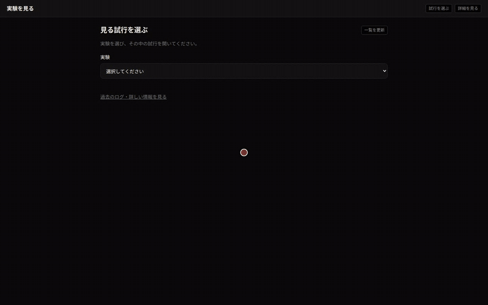
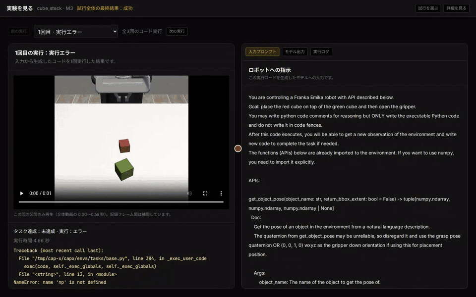
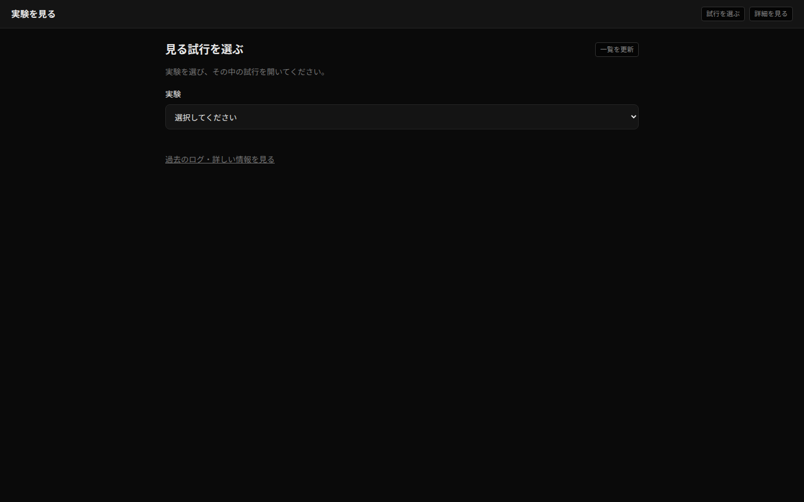
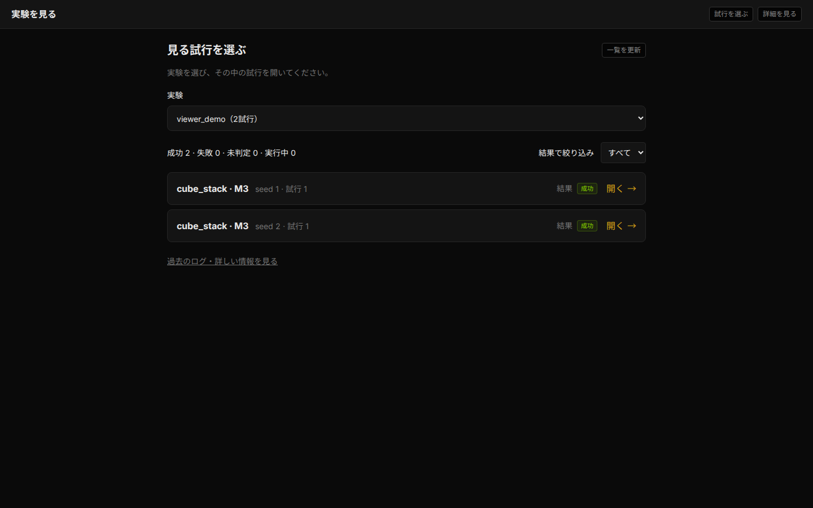
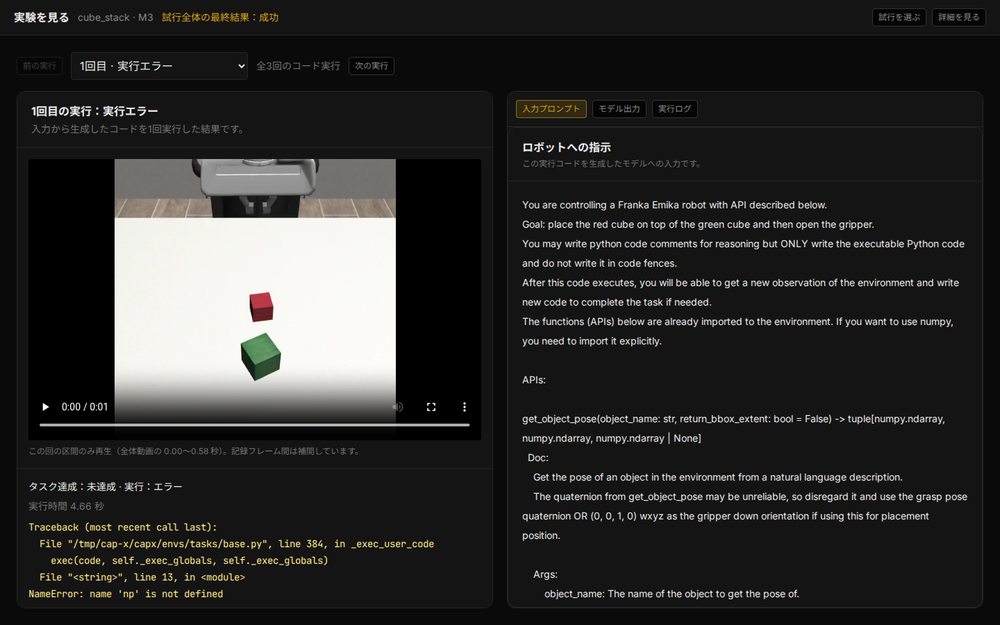
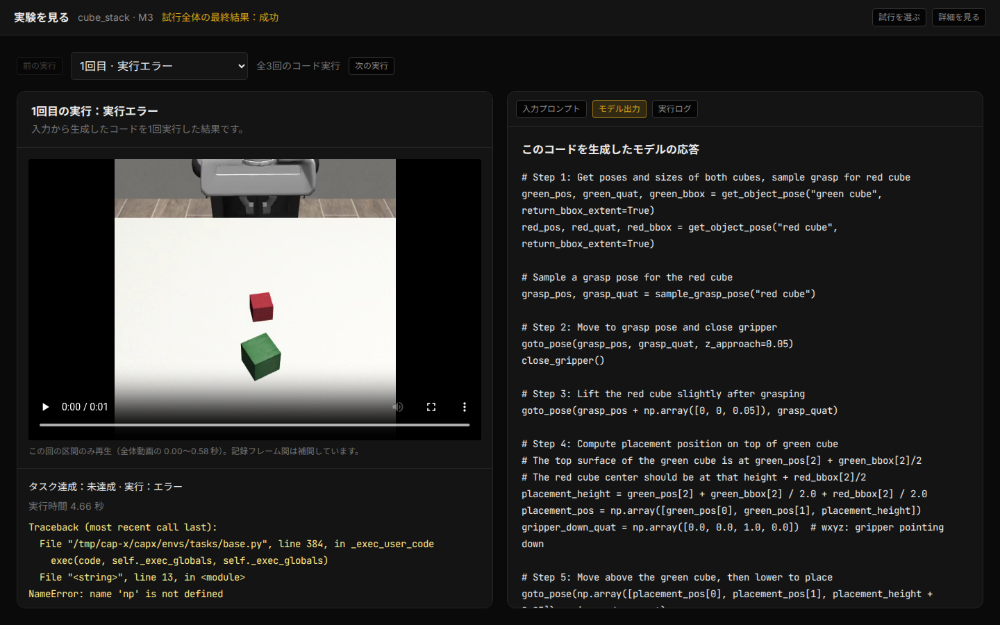
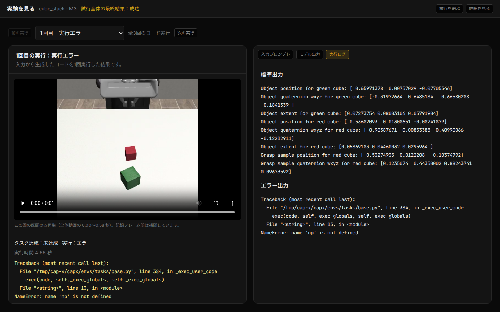
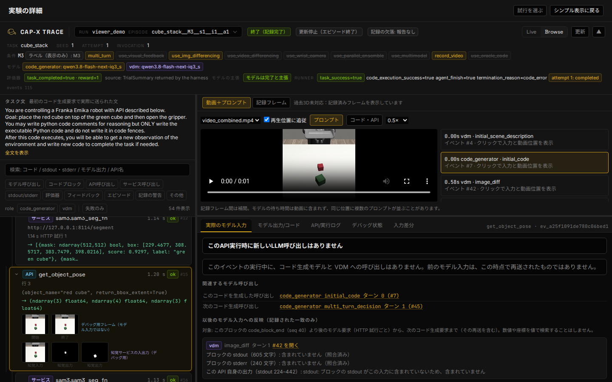

# CaP-X Trace Recorder and Viewer

A trace recorder and web viewer for [CaP-X](https://github.com/capgym/cap-x). CaP-X asks a language model to write Python code that controls a simulated robot. The recorder captures model requests and replies, generated code, API and perception-service calls, console output, evaluator results, and simulator video. The viewer opens those traces in a browser. `scripts/make_demo_trace.py` also writes a synthetic trace that anyone can open.

The distribution contains the `capx_trace_recorder` package, a FastAPI viewer server, and a React frontend. The recorder works with an unmodified upstream CaP-X checkout.

## Demo

Both recordings show one trial of a small run recorded for this README (`viewer_demo`, two trials). The trial is condition M3 of CaP-Bench, Cube Stack with multiple model turns, using the distributed CaP-X configuration and the locally served model `qwen3.8-flash-next-iq3_s`; the robot must put the red cube on the green cube. The model needed three code executions: the first stopped with `NameError: name 'np' is not defined`, the second also raised an error, and the third stacked the cube. The red dot marks each click. The robot images are simulator renderings (robosuite), not photographs of a real robot, and the interface text is in Japanese. The MP4 files (1440 × 900, 30 fps) are in `docs/media` and attached to the [v0.1.0 release](https://github.com/nawta/capx-trace-viewer/releases/tag/v0.1.0).

### Simple view (13 s)



The recording chooses the experiment and opens the trial, then plays the video of its first code execution. It switches to the model output and to the execution log, which shows the `NameError`. It then moves to the third code execution, plays the part of the video where the robot stacks the cube, and returns to the prompt sent to the model. MP4: [docs/media/viewer_demo_simple.mp4](docs/media/viewer_demo_simple.mp4).

### Detailed view (12 s)



The recording opens the detailed timeline of the same trial and selects a `get_object_pose` API call, whose arguments and return values appear on the right. It then selects the SAM3 segmentation service call made inside it. Next it picks the image-difference model request at 0.58 s: the video moves to that time and the right panel shows the exact model input. Last, it searches the timeline for `goto_pose`. MP4: [docs/media/viewer_demo_details.mp4](docs/media/viewer_demo_details.mp4).

To record the demos again against a running server, see [Recording the demo videos](#recording-the-demo-videos).

## Screens

| Screen | What it shows |
|---|---|
|  | **Choose an experiment.** The start page lists the runs found under the trace root, with the number of trials in each. |
|  | **Choose a trial.** Each trial shows task, condition, seed and the final result (success, failure, undetermined, running), with counts and a result filter. |
|  | **Follow one code execution.** Left: the part of the trial video that belongs to the selected code block, the task result, the run time and the error. Right: the exact prompt sent to the model, including the image it received. Multi-turn trials have a selector for each code execution. |
|  | **Model output.** The reply and the code that was executed for this block. |
|  | **Execution log.** Console output and errors of the executed block. |
|  | **Detailed timeline.** All recorded events (model calls, code blocks, API calls, perception-service calls, stdout/stderr, evaluator, feedback, recording warnings) with filters and search, the video synchronised to the selected event, and the details of that event. Here an API call is selected: its arguments, return values and the images given to the perception service. For a model call the same panel shows the normalised request with the origin of each part of the prompt. |

The screenshots show the same `viewer_demo` run. The repository contains no other recorded experiments: only the screenshots and demo videos in `docs/media` and synthetic test fixtures.

## Install and build

```sh
uv venv .venv --python 3.12
uv pip install --python .venv/bin/python -e '.[dev]'
(cd web-ui && npm ci && npm run build)
```

The frontend source is committed, and esbuild is a declared development dependency. `web-ui/dist` is generated locally and ignored by Git. A non-editable wheel does not include the frontend; build it in a source checkout and pass its `dist` directory with `--frontend-dist`. The API works without the build.

## Run

```sh
.venv/bin/python -m capx_trace_viewer.server --viewer-only \
  --trace-root /path/to/traces --runner-root /path/to/runner/outputs \
  --host 127.0.0.1 --port 8290
```

Then open `http://127.0.0.1:8290/traces`. `capx-trace-viewer` is an equivalent installed command. Use `--frontend-dist /absolute/path/to/web-ui/dist` to serve an existing build, including with a wheel install.

### Try it with the synthetic trace

```sh
.venv/bin/python scripts/make_demo_trace.py --out outputs/traces_demo
.venv/bin/python -m capx_trace_viewer.server --trace-root outputs/traces_demo
```

Then open `http://127.0.0.1:8290/traces`.

| Flag | Meaning |
|---|---|
| `--trace-root` | Directory that holds the trace runs (`<run_id>/<episode_id>/events.jsonl`, assets, frames). Defaults to `CAPX_TRACE_DIR`, then `outputs/traces` relative to the working directory. |
| `--runner-root` | One or more directories with the runner's trial outputs (`trials.jsonl`, trial directories with videos). Defaults to `outputs/runner`. |
| `--host`, `--port` | Address to listen on. |
| `--expose-traces` | Allow trace API access from non-loopback clients. Without it, trace routes answer only loopback requests. The option does not add authentication. |
| `--frontend-dist` | Built frontend directory; defaults to this source checkout's `web-ui/dist`. A missing `index.html` returns 503. |
| `--viewer-only` | Accepted and ignored; the viewer always runs in viewer-only mode. |

The viewer serves `/traces` and `/api/traces`; `/` redirects to `/traces`. Relative paths on the command line are resolved against the working directory. See the [trace format specification](docs/trace-format.md) for storage, events and API behavior.

### Security

The viewer has no authentication. Use `--expose-traces` only on a trusted network or behind an authenticating reverse proxy. Anyone who can reach the trace API port can read every file under the trace root. An exposed viewer also shows absolute paths and host names recorded in traces. Review prompts, host names, absolute paths and fallback run ids before sharing a trace. Keep secrets out of traces.

### Frontend development

Start the viewer on port 8290 using the command above. In another terminal, run `cd web-ui && npm ci && npm run dev`. Open `http://127.0.0.1:5173/traces`; Vite forwards `/api` requests to the viewer on port 8290.

## Recording traces

Install this repository into the Python environment that runs CaP-X. Then install the startup hook (a `.pth` file that Python runs at startup) with that environment's interpreter, and run CaP-X as usual:

```sh
uv pip install --python .venv/bin/python /path/to/capx-trace-viewer
.venv/bin/python -m capx_trace_recorder install-pth
export CAPX_TRACE_DIR=./traces
uv run --no-sync --active capx/envs/launch.py --config-path /path/to/config.yaml
```

The startup hook watches for the first CaP-X import in each Python process, including spawned workers. `.venv/bin/python -m capx_trace_recorder status` checks the hook installation. Run `uninstall-pth` before removing the package. After `uv sync`, reinstall the distribution and the hook. To trace a single process, use `python -m capx_trace_recorder run -m module [args...]` or `python -m capx_trace_recorder run script.py [args...]`. Spawned workers need the startup hook. Open recorded runs with `capx-trace-viewer --trace-root ./traces`. See [the trace format](docs/trace-format.md#3-enable-recording) for settings and hook coverage.

If the package is removed but its `.pth` file remains, Python starts silently while tracing is off. With `CAPX_TRACE_DIR` set, each start prints one short `ModuleNotFoundError` line to stderr. To fix this, remove the leftover `.pth` file, or reinstall the package and run `uninstall-pth`.

The recorder has been tested on Linux. On Windows it skips video copying and writes one `unsupported_platform` warning per episode.

If the imported CaP-X package has a `capx/tracing` directory (its own bundled recorder), the public recorder stays inactive and leaves the bundled recorder untouched. A CaP-X package without bundled tracing uses the public recorder. The recorder makes this check at the first CaP-X import, or at activation if CaP-X is already imported.

For an upstream `launch.py` run, the recorder copies trial videos when video recording is on, the trial completes without an exception or timeout, and the trial summary has a `code_path`. Episodes from an experiment runner that supplies its own artifacts use those artifacts. The recorder writes the `trial_videos` event after `episode_end`. Each copy is subject to a per-file size cap and a low-disk check, and the writer queue budget does not apply to it. The warnings `video_missing`, `video_skipped` (with reasons such as `stale`, `turn_index_out_of_range`, and `not_regular`), and `video_size_limit` explain why a video was not copied.

The viewer's simple view matches each turn video to the code block with the same index and plays it at 0.5× speed. When a turn video is missing, it plays the combined video. If it cannot identify the turn's clip in the combined video, it labels the playback as the whole-trial video. Once the run details have loaded and contain no runner records, the header of an upstream trial takes the final result from `task_completed`. The copied videos and results stay with the trace folder when you move it.

In a pip-managed environment, run `python -m pip install /path/to/capx-trace-viewer` and `python -m capx_trace_recorder install-pth` with that environment's Python interpreter. The `run` launcher adds runpy frames to printed stack traces, so use the `.pth` hook when you compare model inputs.

## Tests

```sh
.venv/bin/python -m pytest tests -q
(cd web-ui && npm run test:trace)
```

In the viewer environment, tests that need CaP-X are reported as skipped. To run them against an upstream checkout, set `PYTHONPATH=/path/to/cap-x-upstream` and `CAPX_UPSTREAM_DIR=/path/to/cap-x-upstream`, then run `-m pytest tests/recorder -q` with the CaP-X environment's Python. If that interpreter differs from the one running the tests, set `CAPX_PYTHON` to it for the subprocess import test. Set `CAPX_PYTHON312` to a Python 3.12 interpreter for the optional cross-version checks. Tests that use `/proc`, FIFOs, or SIGALRM run only on Linux and are skipped elsewhere. In an editable install, reinstall this distribution after changing its package layout.

## Recording the demo videos

`scripts/demo/record_demo.py` drives a running viewer in headless Chromium with Playwright, records both scripted sessions and writes `viewer_demo_simple` and `viewer_demo_details` as MP4 and GIF. It needs ffmpeg and the `demo` extra:

```sh
uv pip install --python .venv/bin/python -e '.[demo]'
.venv/bin/python -m playwright install chromium
.venv/bin/python scripts/demo/record_demo.py --base-url http://127.0.0.1:8290 --out-dir docs/media
```

The scenarios (`scripts/demo/scenario_*.js`) find buttons by their interface text. The default labels match the example run above. For another trace, pass `--run`, `--episode`, `--trial-label`, `--api-call`, `--service-call` and `--model-event` with values that appear in it.

## Origin and license

This project builds on [capgym/cap-x](https://github.com/capgym/cap-x) (MIT, Copyright (c) 2026 Max Fu). The recorder, reader, API, and viewer frontend are published here under MIT. `scripts/make_demo_trace.py` writes a synthetic trace. The interface text is Japanese; translations are welcome. Inline SVG icons come from [Heroicons](https://github.com/tailwindlabs/heroicons) (MIT). See [LICENSE](LICENSE).
